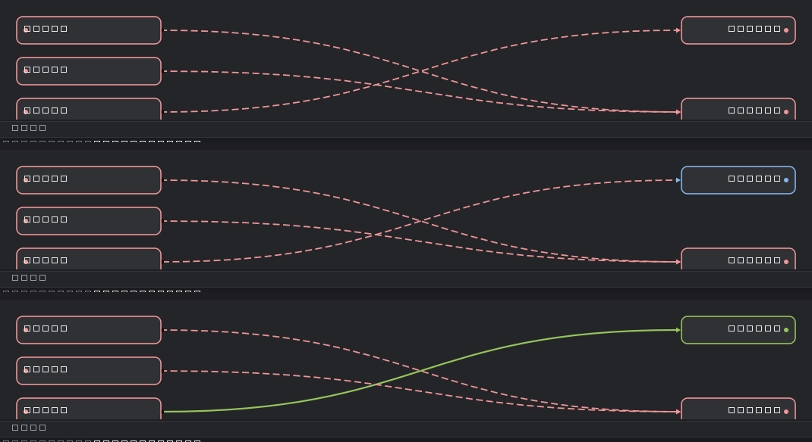

# 图片压缩工具箱 (Image Compressor Toolbox)

一个**拖放式批量图片压缩工具箱**，提供两套界面：

- **GUI（推荐）**：基于 [PySide6](https://doc.qt.io/qtforpython/) 的 Windows 桌面图形界面 — 双击 `run_gui.vbs`（无任何终端窗口）或 `run_gui.bat`，也可运行 `python -m gui.app`
- **TUI**：基于 [Textual](https://textual.textualize.io/) 的纯终端界面 — 运行 `python main.py` 或 `run.bat`

支持 JPEG / PNG / WebP / AVIF / HEIC / GIF / BMP / TIFF，自动按目标体积循环缩小，可选覆盖原文件，动图自动转为 MP4 (H.265)，同目录同分辨率视频可合并转码为 AV1，并利用 NVIDIA / Intel 硬件加速。两套界面共用同一套核心引擎，功能一致。

> 所有可调参数（质量、目标体积、缩放比例、输出格式、动图质量、并行数、输出模式、UI 截断长度、日志目录等）都集中在 `config.toml`，GUI 内可在「设置」对话框直接修改（保留注释），也可以手改文件。

---

## 🖥️ GUI 使用说明 (run_gui.vbs / run_gui.bat)

### 启动方式

| 方式 | 说明 |
| --- | --- |
| 双击 `run_gui.vbs` | **推荐**。完全无终端窗口，连黑框闪烁都没有。可建桌面快捷方式并把图标设为 `assets/app_icon.ico` |
| 双击 `run_gui.bat` | 用 `pythonw.exe` 启动，脚本窗口随即退出，不残留空终端（启动时可能有一闪） |
| `python -m gui.app` | 命令行启动，保留控制台输出，便于调试 |

启动器会自动寻找**装有 PySide6** 的解释器（依次检查 `ICT_PYTHON` 环境变量 → 项目内 `.venv` → PATH 上的 `python.exe`），
找到后用**同目录的 `pythonw.exe`** 启动，因此既不依赖 PATH 顺序，也不会留下终端。
如需固定解释器，先执行一次 `set ICT_PYTHON=D:\Python312\python.exe`（可写入系统环境变量持久生效）。

> 无控制台模式下（`pythonw`），`stdout` / `stderr` / 未捕获异常 / Qt 警告会被自动重定向到
> `logs/gui_console.log`，不会出现"窗口一闪而过但查不到原因"的情况。用 `python.exe` 启动时不启用该兜底。
> 程序内所有 ffprobe / ffmpeg / nvidia-smi 等子进程调用均带 `CREATE_NO_WINDOW` 标志，
> 扫描、合并、转码全程**不会弹出任何终端窗口**。
>
> 每次启动会把实际选中的解释器记入 `logs/launch.log`；启动失败则生成 `logs/launch_error.txt` 并用记事本打开。

> ⚠️ **维护注意（改动这两个文件前必读）**
> - `run_gui.bat` **必须保存为 GBK(936) 编码**。cmd 按系统代码页解析 bat，若存成 UTF-8，
>   中文注释被 GBK 解码后，第二字节会落在 ASCII 可打印区（0x40–0x7E），凭空产生 `"`、`&`、`>`，
>   破坏整段脚本语法 —— 表现为**双击后毫无反应**。
> - `run_gui.vbs` 保持**纯 ASCII**，理由同上（VBScript 同样按系统代码页解析）。
> - 脚本内**不要加 `pause`**：VBS 以隐藏窗口运行，`pause` 会永久等待键盘输入，用户无从察觉。

### 界面布局（自上而下）

| 区域 | 内容 |
| --- | --- |
| 标题栏 | 窗口标题 + 右上角 CPU 实时功耗（需 HWiNFO，见下）+ 硬件徽标 `NVENC ✓/✗ · QSV ✓/✗` |
| 工具栏 | **执行**: 一键开始 / 仅压缩图片 / 停止 · **文件**: 添加文件 / 添加文件夹 / 移除选中 / 清空列表 · **视频**: 合并视频 / 恢复覆盖 · **工具**: 打开输出目录 · 右侧: 设置 / 主题切换 |
| 输出模式 | 「子目录」与「覆盖」分段开关（默认跟随 `config.toml`，当前为覆盖） |
| 图片队列 | 表格：文件名 / 格式 / 原始 / 压缩后 / 节省% / 状态；支持多选、右键菜单（移除、打开所在目录、重试失败项）、双击打开图片 |
| 视频合并 | **合并流图**：平时仅显示右侧目标视频节点（两行文本：文件名 + 所在目录末级目录名，同目录目标相邻排列）；**左键单击目标节点**在左列展开/收起其来源视频链路（同一时间只展开一个，单击空白处收起）；S 形曲线连接（待合并=红虚线 / 合并中=红虚线自源向目标流动 / 已合并=绿实线 / 跳过·超限=灰虚线 / 失败=红实线）；合并完成后自动校验成片时长，异常的目标节点带**红色感叹号**徽标；信息悬停浮窗显示，节点右键菜单（源节点：移除选中 / 打开所在文件夹；目标节点：打开所在文件夹） |
| 运行日志 | 带时间戳的彩色实时日志（与 `logs/*.log` 同源） |
| 底部 | 进度条 + 当前文件 + 统计（成功/跳过/失败/节省体积/视频组数/模式/线程数） |



### 交互

- **拖放**：文件或文件夹拖到窗口任意位置即可入队（可多次拖入自动去重）；`Ctrl+V` 粘贴路径亦可。
- **一键开始**：先压缩图片（阶段1），再合并视频（阶段2）；覆盖模式下启动前会弹确认框。
- **仅压缩图片**：只执行阶段1，不合并视频（当次会话内生效，下次"一键开始"恢复完整流程）。
- **清空列表**：一键移除图片与视频的队列记录（不删除任何文件），同时清空视频合并排除与残留检测状态。
- **设置单位下拉**：带单位的设置项（目标体积、预读阈值、单文件超时、关键帧间隔、合并超时）均为「数字输入框 + 单位下拉框」（如关键帧间隔 2 秒可切为 500 毫秒），保存时自动换算回配置基准单位。
- **停止**：协作式取消 — 已开始的任务会完成，未提交的任务跳过；被截断的批次不执行覆盖。
- **恢复覆盖**：拖入目录时自动检测崩溃残留的 `compressed/`，检测到后按钮亮起，一键移回覆盖原图。
- **设置**：图形化编辑 `config.toml` 全部参数（5 个页签），保存时逐行写回并保留中文注释，下一批次生效。
- **主题**：浅色 / 深色一键切换，选择记忆在 `gui_state.json`。
- **CPU 功耗徽标**（标题栏右上角）：每秒读取 HWiNFO 共享内存中的 "CPU Package Power"。
  前提：正在运行 **HWiNFO64** 且已在 `Settings → Safety` 勾选 **Shared Memory Support**；
  未运行 / 未启用时该标签自动隐藏，不影响其它功能。功耗取值优先级：CPU 传感器的
  Package 功耗 → CPU 传感器的首个功耗读数。
- **视频移除说明**：原始视频右键「移除选中」只把它移出合并列表（不删除文件），且该文件
  在本次会话内不会再被扫描加回（防止误扫描复活）；重启程序后排除清空。
- **合并流图交互**：平时只显示目标视频（`V1.mp4` 一类同名文件用**末级目录名**区分）；
  左键单击目标节点展开它的来源链路（互斥，展开新的自动收起旧的），再点一次或点空白处收起。
- **合并时长校验与修复**：concat 产物/QSV 编码器对不干净的时间戳（PTS 空洞）会放大为
  **成片时长虚增 + 中段冻结帧**（ShanaEncoder 等同类工具也有此问题）。本程序默认：
  ① concat 输入加 `-fflags +genpts`；② 转码前 `setpts=N/fps/TB` 重排视频时间戳
  （`normalize_pts`，成片时长 = 帧数/fps）；③ 完成后校验成片视频流时长 vs 源视频时长之和
  （`duration_check`，容差 `duration_tolerance_pct`% / `duration_tolerance_min_s` 秒取大者），
  偏差过大先尝试从 concat 列表重转码自动修复（`duration_repair`），仍异常则在该目标节点
  标**红色感叹号**并在悬停浮窗给出期望/实际时长。

---

- **拖放式操作**：把文件或文件夹直接拖进终端即可加入队列，可多次拖入自动去重。
- **魔数识别格式**：基于文件头字节判断格式，忽略扩展名欺骗。
- **智能压缩**：解码 → 转 RGB（透明像素用白色/配置底色填充）→ 编码 → 超目标体积则按比例循环缩小，直到达标或达到上限。
- **跳过策略**：压缩后不比原图更小则**不保存直接跳过**；动图在无 FFmpeg 时也会跳过（不报错）。
- **两种输出模式**：
  - **子目录模式**（默认）：输出到 `compressed/` 子目录，原文件只读、不受影响。
  - **覆盖模式**：压缩完成后把 `compressed/` 内的文件移回原目录并覆盖原图；原图与压缩图后缀不同（如 `.png` → `.jpg`）时自动删除旧原图；全部成功才删除 `compressed/`，任一失败则保留。
- **动图转 MP4 (H.265)**：多帧 GIF / WebP / APNG / AVIF 通过 FFmpeg 转成 MP4（编码器按 `hevc_nvenc` → `hevc_qsv` → `libx265` 优先级自动选择）。其中**动画 WebP 由 Pillow 逐帧解码后以原始 RGB 视频流管道喂给 FFmpeg**（FFmpeg 内置 WebP 解码器仅支持静态帧，无法读取 `ANIM`/`ANMF` 动画块）。
- **硬件加速**：自动检测 NVIDIA（NVENC / CUDA 缩放）、Intel QuickSync，否则回退 CPU。
- **多线程并行**：用线程池并行压缩，线程数自动取 CPU 核心数（可配置）。
- **运行日志**：每次运行写入 `./logs/YYYY-MM-DD.log`，记录环境、每张图的压缩结果。

---

## 🖼️ 支持的格式

| 格式 | 识别 | 压缩/处理 | 备注 |
| --- | --- | --- | --- |
| JPEG | ✅ | 压缩 | — |
| PNG | ✅ | 压缩 | 透明区域填充底色 |
| WebP | ✅ | 压缩 / 动图转 MP4 | 静态压缩 + 多帧转视频 |
| AVIF | ✅ | 压缩 | 需 `pillow-heif` |
| HEIC | ✅ | 压缩 | 需 `pillow-heif` |
| GIF | ✅ | 动图转 MP4 | 多帧转视频，单帧当图片压 |
| BMP | ✅ | 压缩 | — |
| TIFF | ✅ | 压缩 | — |

> **HEIC / AVIF 解码依赖 `pillow-heif`**。若未安装，这两类文件会被标记为失败并提示安装该包（不影响其它格式）。

---

## 📦 环境要求与依赖

- **Python 3.11+**（用到内置 `tomllib`，无需额外解析库）
- 必需 Python 包（见 `requirements.txt`）：
  - `textual>=0.47.0`（TUI 框架）
  - `Pillow>=10.0.0`（图片解码/缩放/编码）
  - `pillow-heif>=0.15.0`（HEIC / AVIF 解码）
  - `numpy>=1.24.0`（GPU 缩放路径的数组桥接）
- **可选**：
  - `torch`（含 CUDA）：开启 NVIDIA GPU 缩放加速；不装也能用，回退 CPU LANCZOS。
  - **FFmpeg**（系统二进制）：开启动图 → MP4(H.265)；不装则动图被跳过。
    - Windows：`winget install FFmpeg`
    - macOS：`brew install ffmpeg`
    - Linux：`sudo apt install ffmpeg`

---

## 🚀 安装与运行

```bash
# 1. 进入项目目录
cd image-compressor-toolbox

# 2. 安装依赖（建议使用虚拟环境）
pip install -r requirements.txt

# 3. 启动（Windows 也可直接双击 run.bat）
python main.py

# 可选：启动时直接带入初始路径（文件或文件夹）
python main.py "D:/Pictures/照片" "D:/a.jpg"
```

首次运行会在程序目录下**自动生成 `config.toml`**。

---

## 🕹️ 使用说明

### 添加图片
- **拖放**：将图片文件或文件夹**直接拖进终端窗口**（终端会把路径作为文本粘贴进来，程序自动识别）。
- **粘贴**：复制路径后 `Ctrl+V` 粘贴亦可。
- 拖入文件夹会递归扫描其中所有支持格式的图片并加入列表；可多次拖入，列表自动累积并**去重**。

### 快捷键

| 按键 | 动作 | 说明 |
| --- | --- | --- |
| `s` | 开始压缩 | 对当前列表批量压缩，压缩中锁定队列 |
| `m` | 切换模式 | 在「子目录」与「覆盖」模式间切换 |
| `x` | 清空列表 | 移除队列内所有图片 |
| `c` | 清空日志 | 清空右侧日志面板 |
| `q` | 退出 | 退出程序 |

> 列表中**无法单独删除**某一项，如需移除请按 `x` 清空后重新拖入。压缩完成后可继续拖入新文件进行下一批。

### 状态栏
实时显示：队列数量、已完成数量、当前处理文件名、当前输出模式、检测到的硬件加速类型（如 `NV RTX 3080 Ti`）。

---

## 🔧 压缩策略详解

对每张静态图片：

1. **魔数检测**格式；非图片 / 不支持格式 → 失败。
2. **解码**原图（原文件只读，绝不修改）。
3. **转 RGB**：JPEG 无透明通道，PNG / WebP 等带透明区域时按 `background_color` 填充底色（默认白色）。
4. **编码**：以 `quality`（默认 90）编码为 JPEG（或 `output_format` 指定的格式）。
5. **体积检查**：若输出 > `target_size_mb`（默认 5 MB），按 `scale_step`（默认 0.9，即每次缩 10%）缩小后重新编码，循环往复，最多 `max_scale_iterations`（默认 50）轮。
6. **跳过判定**：若压缩后体积 ≥ 原图，则不保存直接跳过（避免越压越大）。

---

## ⚙️ 硬件加速

程序启动时自动检测（详见状态栏与启动日志）：

1. **NVIDIA GPU**：通过 `nvidia-smi` 或 `torch.cuda` 检测；若同时装了 `torch`，缩放环节走 GPU（`torch.nn.functional.interpolate`，area 模式）。
2. **Intel QuickSync**：通过 `ffmpeg -hwaccels` 检测，用于动图转 MP4。
3. **CPU 软件回退**：Pillow LANCZOS 缩放，通用但较慢。

> JPEG 的编解码始终在 CPU（Pillow）完成 —— NVENC 不支持 MJPEG 输出，所以硬件加速主要用于缩放与视频编码。

---

## 🎬 动图转 MP4 (H.265)

多帧 GIF / WebP / APNG / AVIF 会被交给 FFmpeg 转成 MP4：

- 编码器按 `config.toml` 的 `video.encoder_priority` 顺序择优：`hevc_nvenc`(N卡) → `hevc_qsv`(Intel) → `libx265`(CPU)。
- 质量由 `video.crf`（默认 28，越低越好）控制；单文件转换超时 `video.timeout`（默认 300 秒）。
- 转出的 MP4 比原图更大时同样会跳过。
- **动画 WebP 特殊处理**：FFmpeg 的内置 `webp` 解码器不支持动画 WebP（会报 `image data not found`），因此动画 WebP 由 Pillow 逐帧解码（自动处理帧间合成/透明度），合成到配置的 `background_color` 背景上后，以原始 RGB24 视频流通过 stdin 管道喂给 FFmpeg 编码为 MP4。帧率从 WebP 的 `ANMF` 块中解析的真实帧时长计算（支持可变帧率的平均值），解析失败时回退 24 fps。
- **未安装 FFmpeg** 时，动图会被直接跳过（不报错、不中断批处理）。

---

## 📝 配置说明 (`config.toml`)

修改配置后**重启程序**即生效。文件缺失时自动生成默认版本（带中文注释）。用户配置会与内置默认值**深合并**：缺项自动补默认、未知项忽略，升级默认配置不会破坏旧配置。

| 分组 | 字段 | 默认 | 说明 |
| --- | --- | --- | --- |
| `[compression]` | `quality` | `90` | JPEG 质量 0–100 |
| | `target_size_mb` | `5.0` | 超过此体积则循环缩小 |
| | `scale_step` | `0.9` | 每轮尺寸乘此比例（0.9 = 缩 10%） |
| | `max_scale_iterations` | `50` | 缩小轮数上限（安全阀） |
| | `output_format` | `"jpeg"` | 输出格式（详见下方说明） |
| | `background_color` | `[255,255,255]` | 透明背景填充色 RGB |
| | `progressive` | `true` | 生成渐进式 JPEG |
| | `optimize` | `true` | 优化 Huffman 表 |
| `[output]` | `subdir_name` | `"compressed"` | 输出子目录名 |
| | `default_mode` | `"subdir"` | 启动默认模式：`subdir` / `overwrite` |
| `[parallel]` | `max_workers` | `0` | 并行线程数，0 = 自动（CPU 核心数） |
| `[io]` | `small_file_threshold_mb` | `2.0` | 小于此体积的文件一次性读入内存（减少 SMB/网络往返） |
| | `scan_workers` | `8` | 目录扫描并行线程数（SMB/网络路径建议 8–16） |
| `[video]` | `crf` | `28` | H.265 质量（越低越好） |
| | `encoder_priority` | `["nvidia","intel_qsv","cpu"]` | 动图编码硬件优先级 |
| | `timeout` | `300` | 单文件转换超时（秒） |
| | `extension` | `"mp4"` | 视频输出扩展名 |
| `[video_merge]` | `encoder` / `fallback_encoder` | `av1_qsv` / `libsvtav1` | 合并转码首选/回退 AV1 编码器 |
| | `quality` | `26` | AV1 质量（qsv=global_quality，CPU=crf） |
| | `keyframe_interval` | `2` | 关键帧间隔（秒） |
| | `concat_genpts` | `true` | concat 输入加 `-fflags +genpts` 补全缺失 PTS |
| | `normalize_pts` | `true` | 转码前 `setpts=N/fps/TB` 重排视频时间戳（修复时长虚增/冻结帧；个别 VFR 源可能轻微变速，可关闭） |
| | `duration_check` | `true` | 合并后校验成片时长 vs 源视频时长之和 |
| | `duration_tolerance_pct` / `duration_tolerance_min_s` | `3.0` / `1.0` | 时长偏差容忍（百分比 / 绝对秒下限，取大者） |
| | `duration_repair` | `true` | 时长异常时自动从 concat 列表重转码修复，仍异常标红色感叹号 |
| | `tolerance_px` | `2` | 分辨率分组容差（宽高差 ≤ 此值视为同分辨率） |
| | `max_videos_per_group` / `max_output_files` | `10` / `4` | 单组视频数 / 目标文件数上限 |
| | `output_prefix` / `output_extension` | `V` / `mp4` | 输出命名（V1.mp4…） |
| | `overwrite_existing` | `false` | 目标已存在时覆盖（否则跳过） |
| | `timeout` | `3600` | 单次合并+转码超时（秒） |
| `[ui]` | `max_name_len` | `22` | 状态栏文件名截断长度 |
| | `max_path_len` | `55` | 列表路径截断长度 |
| | `title` | `"图片压缩工具箱"` | 窗口标题 |
| `[logging]` | `log_dir` | `"./logs"` | 日志目录 |

> **关于 `output_format`**：当前完整验证的输出为 `jpeg`。该字段会透传给 Pillow 的编码格式与输出扩展名，改为 `webp` 等时静态图可尝试输出对应格式，但仅 JPEG 经过完整测试；若你启用其它格式遇到问题欢迎反馈。

---

## 📋 日志

- 日志目录：`config.toml` 的 `logging.log_dir`（默认 `./logs`）。
- 文件命名：`imgcompressor_YYYY-MM-DD.log`。
- 记录内容：启动环境（硬件、核心数、FFmpeg 状态、支持格式）、每张图片的原始格式 / 压缩方式 / 缩放次数 / 体积变化、覆盖模式的移动结果。
- 终端内不刷屏，仅写文件；可在界面用 `c` 清空屏幕日志面板。

---

## 📁 项目结构

```
image-compressor-toolbox/
├── main.py            # TUI 主程序（拖放、队列、快捷键、状态栏、覆盖逻辑）
├── compressor.py      # 压缩引擎（单图压缩流水线、跳过判定、输出路径）
├── video_converter.py # 动图 → MP4(H.265) 转换（FFmpeg 三级降级）
├── video_merge.py     # 视频合并转码 AV1（同目录同分辨率分组）
├── detector.py        # 魔数格式识别（8 种格式）
├── hwaccel.py         # 硬件加速检测与 GPU 缩放
├── hwinfo_power.py    # CPU 功耗读取（HWiNFO 共享内存）
├── winproc.py         # 子进程启动标志（CREATE_NO_WINDOW, 无终端弹窗）
├── win_perf.py        # Windows 功耗节流/EcoQoS 规避
├── logger.py          # 日志模块（按日期写入 log_dir）
├── config.py          # 配置加载（自动生成 + 深合并）
├── config.toml        # 用户配置（首次运行自动生成, 不随仓库分发）
├── requirements.txt   # Python 依赖
├── run.bat            # Windows 一键启动 TUI
├── run_gui.bat        # Windows 一键启动 GUI（pythonw, 无残留终端）
├── run_gui.vbs        # GUI 无窗口启动器（双击零闪烁）
├── tools/make_icon.py # 生成 assets/app_icon.ico
├── assets/            # 应用图标（256/128/64/48/32/24/16 多尺寸 ICO）
├── docs/              # 界面预览图
├── test_core.py       # 核心冒烟测试
├── gui/               # 图形界面包 (PySide6)
│   ├── app.py             # 入口（含无控制台日志兜底）
│   ├── main_window.py     # 主窗口（拖放、工具栏、进度、日志）
│   ├── merge_flow.py      # 合并流图（目标节点常驻+单击展开来源链路、悬停详情、右键菜单、时长异常徽标）
│   ├── models.py          # 图片队列 / 视频数据模型
│   ├── workers.py         # 后台线程（扫描/探测/压缩/合并/恢复覆盖）
│   ├── overwrite.py       # 覆盖/恢复覆盖逻辑（纯函数版）
│   ├── settings_dialog.py # 设置对话框（含数字框+单位下拉, 保留注释写回）
│   ├── style.py           # 深/浅主题 QSS
│   └── smoke_test.py      # GUI 冒烟测试 (QT_QPA_PLATFORM=offscreen)
└── logs/              # 运行日志（自动生成, 不随仓库分发）
```

---

## 🧪 测试

```bash
python test_core.py
```

覆盖：单图压缩、体积超限缩小、压后更大跳过、动图转 MP4（需 FFmpeg）、覆盖模式移动逻辑。

视频合并时长链路可用 `tools/test_duration_fix.py` 单独端到端验证（真实 ffmpeg：
干净 CFR / A·V 时长不匹配 / 校验检出 / 自动修复 四个场景，需 QSV 或 CPU AV1 编码器）。

---

## ⚠️ 已知限制 / 注意事项

- **Windows 覆盖模式**：移动文件前会强制 `gc.collect()` 释放残留句柄，避免 `PermissionError`；若仍失败，压缩结果保留在 `compressed/` 中不会丢失。
- **原文件只读**：压缩与解码全程不修改原文件；覆盖模式通过先生成再移动的方式覆盖，失败可回退。
- **动图需要 FFmpeg**：未安装时动图仅被跳过，不会转换。
- **HEIC / AVIF 需要 `pillow-heif`**：未安装时这两类文件压缩失败。
- 输出子目录名固定为 `compressed`，扫描文件夹时会自动跳过已有的 `compressed/` 目录，避免自引用。

---

## 🌐 SMB / 网络路径优化

处理 SMB 共享、NAS、或其它高延迟网络路径上的大量小文件时，每个文件的多轮 I/O 往返会成为瓶颈。程序内置以下优化（通过 `[io]` 配置段控制）：

1. **并行目录扫描**（`scan_workers`）：拖入文件夹后，格式检测（魔数读取）由线程池并行执行，而非逐文件串行。SMB 路径上 8 线程可带来 4–6 倍提速。
2. **`os.scandir` 缓存 stat**：目录遍历使用 `os.scandir()`，`DirEntry.stat()` 的文件大小信息从目录列表缓存中直接获取，无需额外网络往返。
3. **元数据缓存到队列**：扫描阶段检测到的格式 + 文件大小会缓存到待压缩队列中，压缩阶段直接复用，**不再重复调用 `detect_format()` 和 `stat()`**。
4. **小文件预读入内存**（`small_file_threshold_mb`）：体积低于阈值的文件在一次 I/O 中完整读入 `BytesIO`，后续格式检测与 Pillow 解码均从内存缓冲区进行。旧流程每张小文件需要 3–4 次网络往返（检测开/读/关 + stat + Pillow 开 + 读），优化后仅 **1 次**。

> 对于大量小文件（如 500 张 ≤ 2 MB 的 JPEG），SMB 路径上的整体提速可达 **5–10 倍**。
